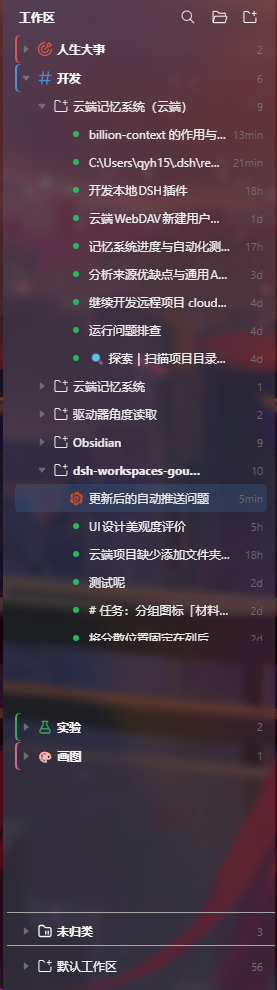

<p align="right">
  <strong>English</strong> · <a href="./README_ZH.md">简体中文</a>
</p>

<h1 align="center">Workspace Groups · Remote SSH</h1>

<p align="center">
  <em>One plugin for DeepSeek Harness — organize workspaces, projects and sessions into a clean grouped sidebar, and develop on remote machines over SSH.</em>
</p>

<p align="center">
  <a href="https://git.qyhhh.top/DeepsSeekHarness/workspace-groups-remote"></a>
  
  
  
</p>

<p align="center">
  
</p>

## ✨ Features

- **Grouped sidebar** — browse by **group → project → session**, with create / rename / delete / fold / pin and drag-and-drop ordering.
- **Group appearance** — colors and icons, including a Materials & Lab set for lab work, material structures and devices.
- **Multiple folders per project** — attach extra folders, pick the default root, and keep each session under the folder that matches its working directory.
- **Remote SSH workspaces** — a VS Code Remote-SSH-like experience: remote workspaces, file access and an integrated terminal, built into the same plugin.
- **Remote-SSH settings page** — connection cards, SSH-key / password auth, import from your system SSH config, per-workspace write-back &amp; sync options. (1.3.0)
- **Duplicate remote folders fixed** — the same remote directory spelled differently no longer registers twice.
- **Session tab strip** — open, switch, pin, rename, reorder and close tabs.
- **Search &amp; persistence** — search sessions in context; groups, order, tabs and folder settings survive refreshes and restarts.

## 🚀 Install

In DeepSeek Harness open **Discover**, search for **Workspace Groups · Remote SSH** and click **Install**. Or install from the command line:

```sh
dsh plugin --profile desktop add https://git.qyhhh.top/DeepsSeekHarness/workspace-groups-remote.git
```

Use `web` instead of `desktop` for a Web profile, then fully restart DSH.

> **Upgrading from the old two-bundle setup?** Remove `workspace-groups-local` and `@zhangfengshun/dsh-remote-ssh` first, install this single package, and restart. Your existing workspaces, sessions and settings are kept.

## 🧭 Quick start

1. Click **New Group** in the sidebar header, then drag projects into it.
2. Use the `⋯` menu on a project or group to manage grouping, appearance and folders.
3. Open **Folders…** on a project to attach folders or choose its default root.
4. For remote work: add an SSH connection in the plugin settings, then create a **remote workspace**.

Automatic grouping by path or name is optional — see [workspace-groups.example.yaml](./workspace-groups.example.yaml) and configure `~/.dsh/workspace-groups.yaml`.

## 📚 More

- [Changelog](./CHANGELOG.md)
- [Example grouping config](./workspace-groups.example.yaml)

## 🙏 Credits &amp; License

Built on [z-col/dsh-workspace-groups](https://github.com/z-col/dsh-workspace-groups) (MIT). This package also bundles [@zhangfengshun/dsh-remote-ssh](https://github.com/zhangfengshun) 2.4.45 (MIT, © ZhangFengshun).

Original work © 2026 zcol; modifications © 2026 newbieQQ. See [LICENSE](./LICENSE) and [NOTICE.md](./NOTICE.md).
