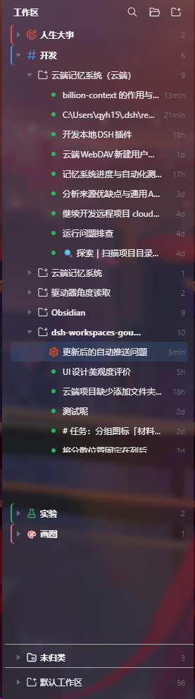

<p align="right">
  <a href="./README.md">English</a> · <strong>简体中文</strong>
</p>

<h1 align="center">工作区分组 · 远程 SSH</h1>

<p align="center">
  <em>DeepSeek Harness 的一个插件 —— 把工作区、项目和会话整理成清爽的分组侧栏，并可通过 SSH 在远程主机上开发。</em>
</p>

<p align="center">
  <a href="https://git.qyhhh.top/DeepsSeekHarness/workspace-groups-remote"></a>
  
  
  
</p>

<p align="center">
  
</p>

## ✨ 主要功能

- **分组侧栏** —— 按「分组 → 项目 → 会话」浏览；支持新建、重命名、删除、折叠、置顶和拖拽排序。
- **分组外观** —— 颜色与图标；内含「材料与实验」图标集。
- **一个项目多个文件夹** —— 为项目添加额外文件夹、选择默认根目录，会话按工作目录归入对应文件夹。
- **远程 SSH 工作区** —— 类似 VS Code Remote-SSH：远程工作区、文件访问与集成终端，同一个插件内完成。
- **Remote-SSH 设置页** —— 连接卡片、密钥/密码认证、从系统 SSH 配置导入、按工作区的写回与同步设置。（1.3.0）
- **修复重复的远程文件夹** —— 同一远程目录换种写法不再重复注册。
- **会话标签栏** —— 打开、切换、固定、重命名、拖动排序与关闭标签。
- **搜索与保存** —— 保留分组层级搜索会话；分组、排序、标签和文件夹设置刷新或重启后仍生效。

## 🚀 安装

在 DeepSeek Harness 打开「发现」，搜索「工作区分组 · 远程 SSH」点击安装；或用命令行：

```sh
dsh plugin --profile desktop add https://git.qyhhh.top/DeepsSeekHarness/workspace-groups-remote.git
```

Web 环境将 `desktop` 改为 `web`，安装后完全重启 DSH。

> **从旧的两个包升级？** 先移除 `workspace-groups-local` 和 `@zhangfengshun/dsh-remote-ssh`，再安装本包并重启。已有工作区、会话和设置都会保留。

## 🧭 上手

1. 点击侧栏标题栏的「新建分组」，再把项目拖进去。
2. 在项目或分组的 `⋯` 菜单中管理分组、外观和文件夹。
3. 在项目的「文件夹…」中添加文件夹或选择默认根目录。
4. 远程开发：在插件设置里添加 SSH 连接，再创建**远程工作区**。

需要按路径或名称自动分组时，可参考 [workspace-groups.example.yaml](./workspace-groups.example.yaml) 配置 `~/.dsh/workspace-groups.yaml`；不配置也不影响手动分组。

## 📚 更多

- [更新日志](./CHANGELOG.md)
- [自动分组示例](./workspace-groups.example.yaml)

## 🙏 致谢与许可

基于 [z-col/dsh-workspace-groups](https://github.com/z-col/dsh-workspace-groups)（MIT）二次开发；本包同时内置 [@zhangfengshun/dsh-remote-ssh](https://github.com/zhangfengshun) 2.4.45（MIT，© ZhangFengshun）。

原始作品 © 2026 zcol；本仓库修改 © 2026 newbieQQ。详见 [LICENSE](./LICENSE) 与 [NOTICE.md](./NOTICE.md)。
